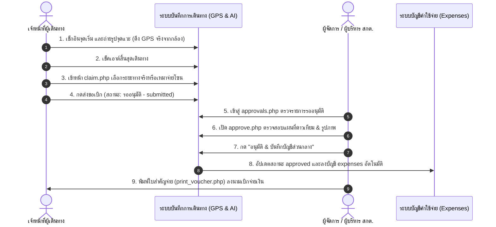

# คู่มือการติดตั้งและผสานระบบการอนุมัติและเบิกค่าใช้จ่าย (Approval & Claims System)
## ระบบบันทึกการเดินทาง (GPS & AI Verification) — สกต.กทม.
*URL ระบบงาน: https://sktbkk.seikouedu.com/travel/*

---

### 1. ไฟล์ที่สร้างขึ้นใหม่ในระบบ

| ชื่อไฟล์ | ตำแหน่งจัดเก็บ | หน้าที่การทำงาน |
| :--- | :--- | :--- |
| **`approvals.php`** | `/travel/approvals.php` | **ศูนย์พิจารณาอนุมัติคำขอเบิกค่าใช้จ่าย**: หน้าแดชบอร์ดสรุปรายการคำขอเบิกทั้งหมด กรองตามเดือน/สถานะ พร้อมปุ่มตรวจสอบหลักฐานและอนุมัติทันที |
| **`print_voucher.php`** | `/travel/print_voucher.php` | **ใบสำคัญจ่าย/ใบเบิกเงินค่าพาหนะทางการ (A4)**: แบบฟอร์มพร้อมพิมพ์ตามระเบียบสหกรณ์ สกต.กทม. มีตารางพิกัดดาวเทียม สรุปเงิน และช่องลงนาม 3 ฝ่าย |
| **`approval_system_interactive.html`** | โฟลเดอร์งาน / เบราว์เซอร์ | **ระบบจำลองการอนุมัติแบบ Interactive**: สำหรับเปิดสาธิตนำเสนอคณะกรรมการบริหาร สกต.กทม. ได้ทันทีโดยไม่ต้องต่ออินเทอร์เน็ต |

---

### 2. วิธีการเชื่อมโยงระบบเข้ากับ `travel/index.php`

ในไฟล์ `travel/index.php` แนะนำให้เพิ่มโค้ด 2 จุดดังนี้:

#### จุดที่ 1: เพิ่มปุ่มทางลัดเข้าสู่ "ศูนย์พิจารณาอนุมัติ" ที่หัวเว็บ (Header)
```php
<?php if (in_array($_SESSION['user']['role'] ?? '', ['admin', 'superadmin', 'skt01'])): ?>
    <a href="approvals.php" class="btn btn-warning fw-bold shadow-sm position-relative">
        <i class="bi bi-shield-check me-1"></i>ศูนย์อนุมัติใบเบิก
        <?php if (!empty($pending_claims_count)): ?>
        <span class="position-absolute top-0 start-100 translate-middle badge rounded-pill bg-danger">
            <?= $pending_claims_count ?>
        </span>
        <?php endif; ?>
    </a>
<?php endif; ?>
```

#### จุดที่ 2: เพิ่มปุ่มดำเนินการในรายการประวัติการเดินทาง (Trip List)
ในลูปแสดงรายการทริปแต่ละรายการ:
```php
<div class="d-flex flex-column gap-1 ms-2">
    <!-- ดูรายงาน/แผนที่ -->
    <a href="report.php?trip_id=<?= $trip['trip_id'] ?>" class="btn btn-sm btn-outline-secondary" title="ดูแผนที่">
        <i class="bi bi-map"></i>
    </a>
    
    <!-- กรณี: รอขอเบิกเงิน -->
    <?php if ($trip['status'] === 'completed' && empty($trip['claim_id'])): ?>
        <a href="claim.php?trip_id=<?= $trip['trip_id'] ?>" class="btn btn-sm btn-success" title="สร้างใบขอเบิกเงิน">
            <i class="bi bi-send"></i>
        </a>
    <?php endif; ?>

    <!-- กรณี: ส่งขอเบิกแล้ว (รออนุมัติ) สำหรับ Admin -->
    <?php if (!empty($trip['claim_id']) && $trip['claim_status'] === 'submitted' && in_array($_SESSION['user']['role'], ['admin', 'superadmin', 'skt01'])): ?>
        <a href="approve.php?id=<?= $trip['claim_id'] ?>" class="btn btn-sm btn-warning fw-bold" title="พิจารณาอนุมัติ">
            <i class="bi bi-shield-check"></i>
        </a>
    <?php endif; ?>

    <!-- กรณี: ได้รับอนุมัติแล้ว สามารถพิมพ์ใบสำคัญจ่ายได้ -->
    <?php if (!empty($trip['claim_id']) && $trip['claim_status'] === 'approved'): ?>
        <a href="print_voucher.php?claim_id=<?= $trip['claim_id'] ?>" target="_blank" class="btn btn-sm btn-outline-primary" title="พิมพ์ใบสำคัญจ่าย">
            <i class="bi bi-printer"></i>
        </a>
    <?php endif; ?>
</div>
```

---

### 3. ขั้นตอนการทำงานครบวงจร (End-to-End Workflow)


